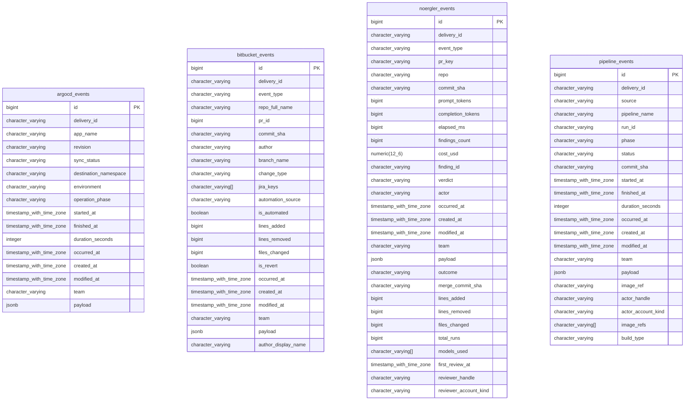

<!-- Generated by github.com/trick77/ship/kit/schemadoc, do not edit. Regenerate in the Go module directory: SCHEMADOC_UPDATE=1 go test ./... -run TestSchemaDoc -->

# Database schema

4 tables, 4 views; the diagram is at the end. Go types are the `model.go` structs whose rows they hold.

## argocd_events

| Column | Type | Null | Default | PK |
| --- | --- | --- | --- | --- |
| `id` | bigint | no | `nextval('argocd_events_id_seq'::regclass)` | 1 |
| `delivery_id` | character varying | no |  |  |
| `app_name` | character varying | no |  |  |
| `revision` | character varying | no |  |  |
| `sync_status` | character varying | yes |  |  |
| `destination_namespace` | character varying | yes |  |  |
| `environment` | character varying | yes |  |  |
| `operation_phase` | character varying | yes |  |  |
| `started_at` | timestamp with time zone | yes |  |  |
| `finished_at` | timestamp with time zone | yes |  |  |
| `duration_seconds` | integer | yes | `generated: (EXTRACT(epoch FROM (finished_at - started_at)))::integer` |  |
| `occurred_at` | timestamp with time zone | no |  |  |
| `created_at` | timestamp with time zone | no | `now()` |  |
| `modified_at` | timestamp with time zone | no | `now()` |  |
| `team` | character varying | yes |  |  |
| `payload` | jsonb | no |  |  |

Indexes:

- `ix_argocd_events_app_name` (`app_name`)
- `ix_argocd_events_environment` (`environment`)
- `ix_argocd_events_revision` (`revision`)
- `ix_argocd_events_team_occurred` (`team`, `occurred_at`)
- `uq_argocd_events_delivery_id` (`delivery_id`) unique

## bitbucket_events

| Column | Type | Null | Default | PK |
| --- | --- | --- | --- | --- |
| `id` | bigint | no | `nextval('bitbucket_events_id_seq'::regclass)` | 1 |
| `delivery_id` | character varying | no |  |  |
| `event_type` | character varying | no |  |  |
| `repo_full_name` | character varying | yes |  |  |
| `pr_id` | bigint | yes |  |  |
| `commit_sha` | character varying | yes |  |  |
| `author` | character varying | yes |  |  |
| `branch_name` | character varying | yes |  |  |
| `change_type` | character varying | yes |  |  |
| `jira_keys` | character varying[] | no | `'{}'::character varying[]` |  |
| `automation_source` | character varying | yes |  |  |
| `is_automated` | boolean | no | `generated: (automation_source IS NOT NULL)` |  |
| `lines_added` | bigint | yes |  |  |
| `lines_removed` | bigint | yes |  |  |
| `files_changed` | bigint | yes |  |  |
| `is_revert` | boolean | no | `false` |  |
| `occurred_at` | timestamp with time zone | no |  |  |
| `created_at` | timestamp with time zone | no | `now()` |  |
| `modified_at` | timestamp with time zone | no | `now()` |  |
| `team` | character varying | yes |  |  |
| `payload` | jsonb | no |  |  |
| `author_display_name` | character varying | yes |  |  |

Indexes:

- `ix_bitbucket_events_commit_sha` (`commit_sha`)
- `ix_bitbucket_events_jira_keys_gin` (`jira_keys`)
- `ix_bitbucket_events_pr_id` (`pr_id`)
- `ix_bitbucket_events_repo_branch_occurred` (`repo_full_name`, `branch_name`, `occurred_at`)
- `ix_bitbucket_events_repo_full_name` (`repo_full_name`)
- `ix_bitbucket_events_repo_pr` (`repo_full_name`, `pr_id`) where `pr_id IS NOT NULL`
- `ix_bitbucket_events_team_occurred` (`team`, `occurred_at`)
- `uq_bitbucket_events_delivery_id` (`delivery_id`) unique

## noergler_events

| Column | Type | Null | Default | PK |
| --- | --- | --- | --- | --- |
| `id` | bigint | no | `nextval('noergler_events_id_seq'::regclass)` | 1 |
| `delivery_id` | character varying | no |  |  |
| `event_type` | character varying | no |  |  |
| `pr_key` | character varying | yes |  |  |
| `repo` | character varying | yes |  |  |
| `commit_sha` | character varying | yes |  |  |
| `prompt_tokens` | bigint | yes |  |  |
| `completion_tokens` | bigint | yes |  |  |
| `elapsed_ms` | bigint | yes |  |  |
| `findings_count` | bigint | yes |  |  |
| `cost_usd` | numeric(12,6) | yes |  |  |
| `finding_id` | character varying | yes |  |  |
| `verdict` | character varying | yes |  |  |
| `actor` | character varying | yes |  |  |
| `occurred_at` | timestamp with time zone | no |  |  |
| `created_at` | timestamp with time zone | no | `now()` |  |
| `modified_at` | timestamp with time zone | no | `now()` |  |
| `team` | character varying | yes |  |  |
| `payload` | jsonb | no |  |  |
| `outcome` | character varying | yes |  |  |
| `merge_commit_sha` | character varying | yes |  |  |
| `lines_added` | bigint | yes |  |  |
| `lines_removed` | bigint | yes |  |  |
| `files_changed` | bigint | yes |  |  |
| `total_runs` | bigint | yes |  |  |
| `models_used` | character varying[] | yes |  |  |
| `first_review_at` | timestamp with time zone | yes |  |  |
| `reviewer_handle` | character varying | yes |  |  |
| `reviewer_account_kind` | character varying | yes |  |  |

Indexes:

- `ix_noergler_events_commit_sha` (`commit_sha`)
- `ix_noergler_events_event_type` (`event_type`)
- `ix_noergler_events_outcome` (`outcome`)
- `ix_noergler_events_pr_completed_newest` (`pr_key`, `(outcome::text = 'deleted'::text)`, `occurred_at`, `id`) where `event_type::text = 'pr_completed'::text`
- `ix_noergler_events_pr_key` (`pr_key`)
- `ix_noergler_events_team_occurred` (`team`, `occurred_at`)
- `uq_noergler_events_delivery_id` (`delivery_id`) unique

## pipeline_events

| Column | Type | Null | Default | PK |
| --- | --- | --- | --- | --- |
| `id` | bigint | no | `nextval('pipeline_events_id_seq'::regclass)` | 1 |
| `delivery_id` | character varying | no |  |  |
| `source` | character varying | no |  |  |
| `pipeline_name` | character varying | no |  |  |
| `run_id` | character varying | no |  |  |
| `phase` | character varying | no |  |  |
| `status` | character varying | yes |  |  |
| `commit_sha` | character varying | yes |  |  |
| `started_at` | timestamp with time zone | yes |  |  |
| `finished_at` | timestamp with time zone | yes |  |  |
| `duration_seconds` | integer | yes | `generated: (EXTRACT(epoch FROM (finished_at - started_at)))::integer` |  |
| `occurred_at` | timestamp with time zone | no |  |  |
| `created_at` | timestamp with time zone | no | `now()` |  |
| `modified_at` | timestamp with time zone | no | `now()` |  |
| `team` | character varying | yes |  |  |
| `payload` | jsonb | no |  |  |
| `image_ref` | character varying | yes |  |  |
| `actor_handle` | character varying | yes |  |  |
| `actor_account_kind` | character varying | yes |  |  |
| `image_refs` | character varying[] | no | `'{}'::character varying[]` |  |
| `build_type` | character varying | yes |  |  |

Indexes:

- `ix_pipeline_events_commit_sha` (`commit_sha`)
- `ix_pipeline_events_image_refs_gin` (`image_refs`)
- `ix_pipeline_events_pipeline_name` (`pipeline_name`)
- `ix_pipeline_events_source` (`source`)
- `ix_pipeline_events_team_occurred` (`team`, `occurred_at`)
- `uq_pipeline_events_delivery_id` (`delivery_id`) unique

## Views

- `commit_sightings` (view)
- `deploy_commit_ranges` (view)
- `lead_time_changes` (view)
- `noergler_pr_rollups` (view)

## Types not stored as rows

### store.Activity

In `internal/store`. Activity is how many events one sender identifier produced: a count per source, identifier and team over the four event tables.

| Field | Type | Doc |
| --- | --- | --- |
| `Source` | `string` | bitbucket \| pipeline \| argocd \| noergler |
| `Identifier` | `string` | repo_full_name / pipeline_name / app_name / repo |
| `Team` | `string` |  |
| `Events` | `int64` |  |

## Diagram

